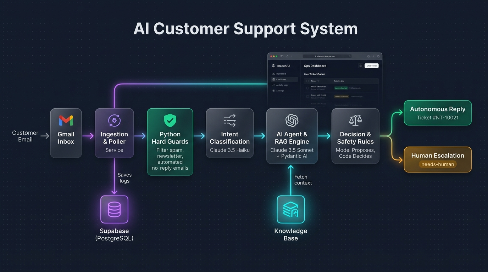

# Neem & Teak - Autonomous AI Customer Support Agent & Dashboard

> Simple help for everyday home and kitchen needs.



An end-to-end autonomous customer support automation system with an AI pipeline, safety guardrails, human escalation, and a modern React + shadcn/ui operational dashboard.

---

## Overview

Neem & Teak is a home and kitchen brand selling products such as mixer grinders and flat-pack bookshelves. This system automates email customer support end-to-end:
- Ingests customer support inquiries via the Gmail API.
- Evaluates inbound messages against strict deterministic Python safety rules.
- Classifies customer intent using lightweight language models (Claude 3.5 Haiku).
- Retrieves relevant store policies and drafts factual responses using retrieval-augmented generation (Claude 3.5 Sonnet via Pydantic AI).
- Automatically escalates edge cases, returns, and damages to human agents.
- Assigns persistent multi-digit ticket references (`NT-10021`) for email thread tracking.
- Provides a real-time operational dashboard for monitoring pipeline activity, reviewing ticket histories, and updating store knowledge base articles.

---

## System Architecture

```
                 +----------------------------------------+
                 |             Gmail Inbox                |
                 +-------------------+--------------------+
                                     | (poll unread)
                                     v
                 +----------------------------------------+
                 |           app/guards.py                |
                 | (Filters noreply, newsletters, spam)   |
                 +-------------------+--------------------+
                                     | (valid customer email)
                                     v
                 +----------------------------------------+
                 |      Pydantic AI Classifier            |
                 |      (Claude 3.5 Haiku)                |
                 +-------------------+--------------------+
                                     |
                                     v
                 +----------------------------------------+
                 |       Pydantic AI Agent                |
                 |       (Claude 3.5 Sonnet + RAG)        |
                 +-------+--------------------------+-----+
                         |                          |
                  [Action: Answer]           [Action: Escalate]
                         |                          |
                         v                          v
                Send Reply [NT-10021]        Add 'needs-human' label
                         |                          |
                         +------------+-------------+
                                      |
                                      v
                 +----------------------------------------+
                 |       Supabase (PostgreSQL)            |
                 | (events, tickets, messages, knowledge) |
                 +--------------------+-------------------+
                                      |
                                      v
                 +----------------------------------------+
                 |     React + shadcn/ui Dashboard        |
                 |   (Served securely via FastAPI)        |
                 +----------------------------------------+
```

---

## Key Features

### 1. Deterministic Guardrails & Loop Prevention
- **Mailing List Detection**: Scans RFC headers (`List-Unsubscribe`, `List-ID`, `Precedence: bulk/list/junk`) to automatically ignore automated campaigns.
- **Automated Sender Suppression**: Flags `noreply`, `mailer-daemon`, `postmaster`, and notification addresses before invoking language models.
- **Gmail System Category Filtering**: Automatically skips messages categorized under `CATEGORY_PROMOTIONS`, `CATEGORY_SOCIAL`, or `CATEGORY_FORUMS`.
- **Bounce Suppression**: Detects non-delivery reports (NDRs), delivery failure notices, and authentication alerts to prevent infinite response loops.

### 2. Multi-Stage AI Pipeline
- **Classification Stage**: Uses Claude 3.5 Haiku for rapid intent classification across catalog domains (`mixer_grinders`, `bookshelves`, `returns_warranty`, `shipping`).
- **Generation & Tool Retrieval Stage**: Uses Claude 3.5 Sonnet with Pydantic AI tools to fetch authoritative documentation directly from the PostgreSQL knowledge base.
- **Rule-Based Routing**: Hard constraints dictate whether a proposal can be executed autonomously or requires manual staff review.

### 3. Human-in-the-Loop Escalation
- Complex requests (damaged goods, custom warranty claims, explicit requests for human assistance) are flagged with the `needs-human` label in Gmail.
- The pipeline updates the internal ticket state to `escalated` with proposed next steps, transferring thread ownership to human staff.

### 4. Multi-Digit Ticket Threading
- Each customer thread receives an immutable reference identifier (e.g. `NT-10021`).
- Outgoing responses format the subject line as `Re: [NT-10021] <Subject>`, allowing follow-up emails from customers to automatically thread into the same ticket record.

### 5. Operational Dashboard
- **Events Log**: Real-time pipeline audit log with metric cards, instant search, and status filtering.
- **Tickets Queue**: Split-pane interface displaying customer ticket queues and chronological thread message history.
- **Knowledge Base Editor**: Markdown editor enabling staff to update product documentation and return policies in real time without redeploying services.
- **Authentication**: HTTP Basic Authentication (`admin` + configured secret) protecting all dashboard and administrative API routes.

---

## Technology Stack

- **Backend**: Python 3.13, FastAPI, Pydantic AI, Psycopg 3, Uvicorn
- **AI Models**: Anthropic Claude 3.5 Sonnet (Agent/RAG), Claude 3.5 Haiku (Classifier)
- **Database**: PostgreSQL (Supabase) with connection pooling support
- **Email Integration**: Google APIs (Gmail API v1 with OAuth2 refresh flow)
- **Frontend**: React 19, TypeScript, Vite, Tailwind CSS v4, Radix UI, shadcn/ui
- **Containerization**: Docker (multi-stage build with Astral uv)

---

## Installation & Local Development

### Prerequisites
- Python 3.13 or higher with `uv` installed
- Node.js 20 or higher with `npm`
- PostgreSQL database instance (local or hosted via Supabase)
- Google Cloud OAuth 2.0 Client credentials with Gmail API enabled
- Anthropic API Key

### 1. Clone Repository & Install Dependencies
```bash
git clone https://github.com/Sayan-CtrlZ/ai-customer-support.git
cd ai-customer-support

# Install Python environment and locked dependencies
uv sync

# Install frontend dependencies
cd dashboard
npm install
cd ..
```

### 2. Environment Configuration
Copy `.env.example` to `.env` and populate the required credentials:
```bash
cp .env.example .env
```

| Variable | Description |
| :--- | :--- |
| `GOOGLE_CLIENT_ID` | Google OAuth2 Client ID |
| `GOOGLE_CLIENT_SECRET` | Google OAuth2 Client Secret |
| `GOOGLE_REFRESH_TOKEN` | OAuth2 Refresh Token authorized for `gmail.modify` |
| `ANTHROPIC_API_KEY` | Anthropic API Key for Claude model access |
| `DATABASE_URL` | PostgreSQL connection string |
| `CLASSIFIER_MODEL` | Classifier model string (default: `anthropic:claude-haiku-5-5`) |
| `AGENT_MODEL` | Generator model string (default: `anthropic:claude-sonnet-5-5`) |
| `POLL_INTERVAL_SECONDS` | Inbox polling interval in seconds (default: `60`) |
| `ENABLE_AUTO_POLLER` | Enable automatic background polling (`true` or `false`) |
| `DASHBOARD_USERNAME` | Admin dashboard username (default: `admin`) |
| `DASHBOARD_PASSWORD` | Admin dashboard password |

### 3. Initialize Database Schema
Seed the knowledge base articles into PostgreSQL:
```bash
uv run python scripts/seed_knowledge_base.py
```

### 4. Running the Application

#### Option A: Dual-Server Development Mode (Recommended)
Runs the React dashboard with Vite hot module replacement (HMR) and FastAPI with auto-reload:

```bash
# Terminal 1: Backend API
uv run fastapi dev app/main.py

# Terminal 2: Frontend Dashboard
cd dashboard && npm run dev
```
- Dashboard: `http://localhost:5173`
- Backend API: `http://127.0.0.1:8000`

#### Option B: Unified Production Server
Compiles static React assets and serves both the API and dashboard from FastAPI on a single port:

```bash
# Build frontend bundle
cd dashboard && npm run build && cd ..

# Launch production server
uv run uvicorn app.main:app --host 127.0.0.1 --port 8000
```
- Access at: `http://127.0.0.1:8000`

---

## Deployment

### Docker Container Deployment
The application includes a multi-stage `Dockerfile` that compiles the React dashboard and packages the Python backend:

```bash
# Build Docker image
docker build -t neem-teak-support .

# Run container
docker run -d \
  --name support-bot \
  --restart unless-stopped \
  --env-file .env \
  -p 8080:8080 \
  neem-teak-support
```

### Hosting on Render
1. Connect the GitHub repository in the Render console as a **Web Service**.
2. Select runtime **Docker**.
3. Set the Environment Variables (`DATABASE_URL`, `ANTHROPIC_API_KEY`, `GOOGLE_*`, `DASHBOARD_*`).
   * *Note for Supabase*: Ensure `DATABASE_URL` uses the IPv4 connection pooler endpoint (`*.pooler.supabase.com`) rather than direct connections to prevent IPv6 connectivity errors.
4. Set `ENABLE_AUTO_POLLER=false` if on-demand polling via the dashboard is preferred, or `true` for continuous background execution.

### Hosting on a Virtual Private Server (DigitalOcean Droplet)
1. Provision an Ubuntu 24.04 LTS instance.
2. Configure basic firewall protection:
   ```bash
   ufw allow OpenSSH
   ufw enable
   ```
3. Install Docker and clone the repository:
   ```bash
   apt update && apt install -y docker.io git
   git clone https://github.com/Sayan-CtrlZ/ai-customer-support.git
   cd ai-customer-support
   ```
4. Create `.env` and execute the container bound to `127.0.0.1:8080`.
5. Connect securely from your local workstation using an SSH tunnel:
   ```bash
   ssh -N -L 8080:localhost:8080 root@<DROPLET_IP>
   ```
6. Access the dashboard at `http://localhost:8080`.

---

## License

This project is licensed under the MIT License.
